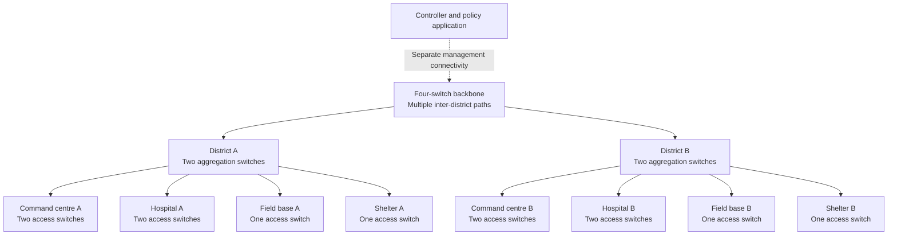

# SDN for Adaptive Emergency Communications

## 1. Project description

This academic project will design, implement, and test a software-defined network
for coordinating emergency data communications across two neighbouring districts
during a disaster. It will connect emergency operations centres, hospitals, field
command posts, and shelters through multiple network paths with different capacities.

The main objective is to demonstrate how an operational request, such as
“protect dispatch messages during evacuation,” can become coordinated forwarding,
bandwidth, and access-control changes across the network. We will measure whether
those changes work during congestion, infrastructure failures, and recovery.

The project will use Mininet, Open vSwitch, and an OpenFlow controller. It is an
emulation of a managed emergency IP network, rather than a complete national
disaster-communications deployment.

**Status:** This document describes the proposed redesign. The existing project is
a smaller foundation; the features below must not be presented as already built
or validated.

## 2. Academic requirements and how we address them

| Requirement | Proposed response |
|---|---|
| Clear reason for choosing SDN | Coordinated, incident-driven changes across several sites and devices |
| Understanding and innovation | Explain control/data separation and implement a small incident-policy system |
| Complex, meaningful topology | Two districts, three network layers, alternate paths, critical-site access redundancy, and separate network segments |
| Connection to early SDN talks | Map verified historical ideas to specific implemented features |
| Four group members | Four repeatable live problem-and-solution demonstrations |
| Unexpected professor task | Generic inspection and policy commands rather than demonstrations tied to hard-coded host numbers |
| Real-world credibility | Explicit deployment assumptions, dependencies, failure cases, and limitations |
| Rigorous testing | Automated checks, repeated experiments, negative tests, and preserved evidence |

## 3. Why choose SDN?

Disaster response requires communication, resilience, and traffic prioritisation.
It does not inherently require SDN. Conventional routing, access controls, and
DiffServ QoS can provide many of the same individual functions.

Our justification is that incident requirements change across multiple sites:

- During evacuation, dispatch messages and shelter updates need protection.
- During a search, an authorised drone stream may need more capacity.
- When a link fails, the remaining route may have less bandwidth.
- A newly connected field device may need restricted access to selected services.

We will use programmable control to coordinate these decisions and inspect their
effects. Rule changes are the mechanism; consistent application of operational
policy is the purpose.

We will compare adaptive policies with both best-effort forwarding and fixed QoS.
An improvement over best effort alone would not establish an advantage over
conventional QoS or other automation systems.

## 4. Real-world situation and comparison

### 4.1 What actually happens during disaster response

Responders need local communication, a way to report to an operations centre, and
coordination between agencies. Depending on the incident and location, they use a
mixture of radio, mobile networks, terrestrial data links, and satellite services.
Communications personnel may deploy temporary equipment when normal connectivity
is unavailable. Power, access to the site, equipment compatibility, and staffing
affect whether that equipment can operate.

Indian examples support this mixed-network model:

- Kerala SDMA lists optical fibre, mobile phones, satellite phones, VSAT, and
  police wireless among its emergency operations centre communications.
  [Kerala SDMA communication systems](https://sdma.kerala.gov.in/communication/)
- NDRF's Operation Dost account describes HF/VHF communication between teams
  and satellite terminals for communication with headquarters.
  [NDRF Operation Dost account](https://www.ndrf.gov.in/sites/default/files/Operation%20Dost%20NDRF%20in%20Turkiye%20Special%20Edition.pdf)
- Meghalaya SDMA's NDMS description explains the planned combination of
  terrestrial connectivity, VSAT, satellite phones, and HF radio for emergency
  coordination. This is programme documentation, not proof of the current
  operational condition of every listed site.
  [NDMS description](https://www.msdma.gov.in/ndms.html)

These sources establish operational needs and communication methods. They do
not establish that those organisations use our proposed SDN architecture.

### 4.2 Where our project fits

Our system represents the managed IP portion between site networks, field
gateways, and operations centres. A field responder reaches this portion through
a gateway or communication service. We are not modelling an ambulance as having
a direct Ethernet cable to a distant district switch.

| Real-world element or issue | Representation in our project | What remains outside the emulation |
|---|---|---|
| District emergency operations centres | District A and District B command networks | Actual staffing, facilities, and administrative processes |
| Hospital, shelter, and field command post | Site switches, endpoints, and representative applications | Complete hospital systems and field equipment |
| Responders using radio or mobile access | Endpoints behind a field gateway | Radio propagation, spectrum, cellular attachment, and handovers |
| Normal terrestrial backhaul | Higher-capacity paths with configured delay | Actual fibre routes and carrier equipment |
| Temporary alternative backhaul | A separately configured path with constrained bandwidth and delay | Physical satellite, microwave, or cellular equipment and link establishment |
| Damage to infrastructure | Removing links or stopping switches | Structural damage, repairs, and physical hazards |
| Sudden demand for information | Concurrent dispatch, report, video-like, and bulk workloads | Complete operational applications and human behaviour |
| Need-to-know access | Network segments and service-level access policies | Full identity federation, clinical authorisation, and organisational agreements |
| Loss of commercial power | Removing the affected devices from the topology | Battery discharge, generators, fuel, and electrical switching |
| Controller isolation | Disconnecting the controller's management path | Complete geographical and physical resilience |
| Recovery | Restoring devices and checking state reconciliation | Actual field repair and deployment time |

### 4.3 The incident we will demonstrate

Flooding affects two neighbouring districts. Some normal links remain usable,
while one district loses a primary connection. A temporary backup connection is
available but has less capacity. Rescue teams, a hospital, and shelters still
need to exchange urgent information with their district operations centre.

The system must select available paths, protect essential data, restrict routine
transfers when necessary, and preserve access restrictions. When a district has
no external connection, available local services should continue and remote
services must be reported unavailable. We will not pretend that routing can
create a missing physical connection.

## 5. Scope and control boundary

### Included

- Topology-aware forwarding over a redundant managed network.
- Multiple site subnets and controlled communication between them.
- Application-level traffic classes and incident profiles.
- Bandwidth allocation at deliberately shared bottlenecks.
- Access controls and checks against simple address impersonation.
- Link failures, selected switch failures, controller disconnection, and recovery.
- Critical-site endpoint connection failover.
- Measurements, automated verification, and repeatable presentation commands.

### Outside the implementation scope

- Building a cellular network, satellite system, or public-safety radio system.
- Controlling a provider's internal infrastructure without its cooperation.
- Proving real battery runtime, generator reliability, or equipment ruggedness.
- Claiming continuous service when every usable path or power source is lost.
- Claiming a production controller cluster, complete cybersecurity, or medical
  certification.

We may model an external service as a link, but SDN policies will only control
our own switches and gateways. End-to-end priority cannot be guaranteed across
an external network that does not honour it.

## 6. Proposed topology

### 6.1 Size and structure

The earlier 16-switch proposal is the structural starting point. Adding a second
access switch at each command centre and hospital produces the recommended
**20-switch target**, with approximately **24 application endpoints**.

| Component | Quantity | Purpose |
|---|---:|---|
| Backbone switches | 4 | Multiple paths within and between district backbone portions |
| Regional aggregation switches | 4 | Two per district, connecting sites to the backbone |
| Site access switches | 12 | Two at each of four critical sites; one at each of four other sites |
| Application endpoints | About 24 | Three per site initially, with several workloads per endpoint where needed |
| Controller process | 1 initially | Programme and observe the managed network |

The eight sites are a command centre, hospital, field base, and shelter in each
district. The four critical sites are the two command centres and two hospitals.
Management interfaces and any additional test infrastructure are accounted for
separately from the application-endpoint count.

This diagram groups devices. Each site access switch has separate uplinks to
both of its district's aggregation switches; the single arrows do not mean a
single physical uplink. The final detailed diagram must show individual ports,
links, subnets, link characteristics, and failure domains.

### 6.2 Connection rules

- Each aggregation switch connects to two backbone switches.
- Backbone connections provide alternative inter-district routes. At least one
  backup path has lower capacity, making route and bandwidth decisions meaningful.
- Critical endpoints have two interfaces, connected to different access switches.
- The initial endpoint failover design uses active-backup bonding within the
  same logical site network. Separate IP networks would need an additional
  routing/application recovery design and are not an automatic substitute.
- Only critical endpoints are promised access-switch failover. Other devices
  connected to a failed access switch will lose service.
- Site subnets and access policies keep guest, medical, and operational traffic
  separated where required. The design must include explicit gateway/routing
  behaviour rather than extending the existing flat subnet everywhere.

More paths create a loop risk. Broadcast and unknown traffic must follow a
controlled, loop-free mechanism. We will use an explicit broadcast tree or proxy
ARP for supported endpoints, and topology-derived unicast rules. We will not
enable unrestricted flooding over a mesh.

### 6.3 Meaningful limits to redundancy

Two switches do not protect an endpoint connected to only one of them. Two
uplinks do not protect against both links sharing a failed upstream component.
Separate logical paths may still share a cable route, building, or power source.

The deployment design will identify these shared dependencies. The Mininet
experiment runs on one machine and therefore cannot demonstrate survival of
that machine's physical failure.

## 7. Software design and technology

Continue with Mininet, Open vSwitch, and OpenFlow 1.3. Start from the existing
Ryu environment, record its working Python/dependency versions, and validate
required OpenFlow features before expanding the topology. A controller migration
is not a project objective; any necessary change must be justified by a concrete
compatibility or functionality blocker.

| Module | Responsibility |
|---|---|
| Topology configuration | Define sites, device IDs, port bindings, addressing, links, and capacities |
| Topology and host state | Track usable links and authorised endpoint attachments; identify stale state |
| Routing | Compute allowed paths and install correct forward and return rules |
| Broadcast/ARP handling | Prevent loops and support address resolution within policy boundaries |
| Policy engine | Translate incident profiles into bandwidth, routing, and access requirements |
| QoS manager | Configure queues consistently and map sufficiently specific flows to them |
| Access enforcement | Apply default restrictions and configured endpoint/service permissions |
| Monitoring | Collect application results, path state, flow counters, and queue counters |
| Operator interface | Inspect, change, validate, and revert policies using documented commands |
| Experiment runner | Start workloads, inject faults, collect evidence, and reset the lab |

Use one source of configuration for host identities, ports, subnets, and queue
definitions. Avoid copying independent hard-coded values between scripts.

Controller decisions must account for delayed or stale observations. Changes
need a defined installation order and verification; a series of OpenFlow messages
must not be described as an atomic network-wide transaction. Failed or partial
updates must trigger a reported error and a tested rollback or recovery path.

## 8. Traffic and incident policies

Priority belongs to an authorised application and operational need, not simply
to an agency name or a claimed port number.

| Traffic | Example workload | Intended treatment |
|---|---|---|
| Dispatch and distress information | Small periodic messages with sequence numbers and replies | Protected capacity and measured delivery/response time |
| Medical coordination | Patient-transfer reports or representative TCP transfers | Authorised access and protected capacity |
| Search video | A paced video-like stream from an authorised endpoint | Higher allocation during a search when capacity permits |
| Shelter information | Occupancy and supply updates | Reliable access; priority can rise during evacuation |
| Routine bulk transfers | File synchronisation or backups | Restrict first when capacity is insufficient |
| Guest traffic | Non-operational traffic | Isolated and limited |

Implement profiles for normal operation, evacuation, search-and-rescue, and
degraded connectivity. Each profile has explicit permitted services, allocations,
and fallback behaviour.

Before applying a profile, check whether requested protected capacity fits on
the chosen paths. If it does not, report the conflict and apply a predefined
admission/degradation policy. Do not promise every critical application unlimited
bandwidth. Use stable thresholds and a hold-down period where automatic decisions
could otherwise cause repeated path or policy changes.

## 9. Four live demonstrations

Each member owns one main demonstration. All members should understand the shared
architecture and be able to explain the other demonstrations.

The Phase 4 helpers implement the simplified designs below; their live rehearsal
gate is recorded separately in HANDOFF.md. On 2026-10-16 the user approved reusing
the existing whole-profile checkpoint/rollback for demonstration 4, replacing its
previous dedicated two-switch, single-class updater to reduce development time.
Each student must create the problem, diagnose it from evidence,
choose and execute a corrective action, and verify recovery. Setup, injection,
inspection, policy application, measurement, and reset may have separate helper
commands. No single command should perform the entire assessed demonstration.
Automated tests may still run complete sequences for repeatability checks.

Target comparable student effort and 3-4 minutes per demonstration with the lab
already prepared. Each uses one bounded problem, a concise inspection view, one
corrective decision, and positive/negative verification through separate
operations. Use prepared profiles, a small set of computed route candidates,
one onboarding endpoint, and one saved policy rollback; do not require live code
editing or hand-written OpenFlow rules. These tools still validate requests and
report real installed state. Similar student difficulty does not imply equal
implementation effort: partial-update recovery remains the hardest mechanism.
Timing is a rehearsal target, not a measured result. Suggested budget: 30 seconds
to establish baseline/inject, 60 seconds to inspect/explain, 45 seconds to apply
the correction, and 60-105 seconds to verify/save evidence and reset.

Keep intended automatic rerouting, admission/degradation, access rejection, and
reconnection behaviour. Explain what the controller does automatically and what
the student decides. Do not disable working protection to manufacture a task.

| Member | Student-injected problem | Student's corrective action | Evidence |
|---|---|---|---|
| 1 | Start bulk traffic that congests a verified shared egress under the starting policy | Identify contention and apply an incident profile protecting urgent messages | Same offered load before/after, delivery/RTT, throughput and queue counters |
| 2 | Disable a primary link; ordinary backup does not meet an additional avoid-switch requirement | Select and apply a surviving, permitted, capacity-feasible candidate while the link stays down | Forward/return path evidence, component avoidance, successful service and continued forbidden-access rejection |
| 3 | Activate a prepared but unregistered endpoint requiring one reporting service | Register its authorised attachment, then grant only the exact required service permission | Denied before registration and before permission; permitted service succeeds afterward while unrelated services/spoofing fail |
| 4 | Pause a profile update after its first switch is verified, isolate a second populated switch, then resume | Inspect partial status and explicitly roll reachable switches back to saved V1 while the isolated switch retains V1 | Per-switch V1 state, no active leftover V2 rules, traffic continuity and explicit verification status |

### 9.1 Member 1: Restore urgent communication during congestion

1. Establish the normal profile and record successful urgent-message traffic
   with its configured delivery and RTT budgets.
2. The student starts concurrent routine bulk transfers through the same known
   constrained egress. Keep offered workloads running throughout the correction.
3. Show the resulting urgent-message degradation. Inspect the selected path,
   egress capacity, traffic rates, queue counters, and current allocations to
   identify contention rather than an access or link failure.
4. The student chooses and applies the evacuation profile or a validated
   allocation change that protects urgent messages and limits routine bulk.
5. Verify actual rules/queues and application delivery/RTT under the same offered
   load; show the cost to bulk throughput and save before/after evidence.
6. Stop owned workloads, restore the starting profile, and verify the baseline.

Rehearsal must establish a visible problem under the starting policy and a
capacity-feasible correction. If urgent traffic already meets every declared
goal, report that honestly and do not claim a measured recovery.

### 9.2 Member 2: Apply a constrained route while a link stays down

1. Prepare a normal route and two surviving alternatives for one endpoint/service
   pair: the ordinary backup and a route that also avoids a specified backbone
   switch. Verify that the ordinary backup does not already meet this additional
   requirement and that a permitted, capacity-feasible solution exists.
2. The student disables a named primary link. Observe and credit automatic
   rerouting, then inspect link state and the actual replacement path.
3. Present a small set of topology-derived candidates with usable capacity and
   allowed/forbidden component information. The student explains which candidate
   meets the avoid-switch requirement and selects it; the controller revalidates
   current state and aggregate admitted rates on every affected directed link.
4. Apply the route for the selected service, generating forward and return rules
   without changing access restrictions. Keep the failed link down.
5. Verify service requests, avoidance in both directions, and continued rejection
   of forbidden traffic. Use flow counters/captures to support the path report.
6. Save evidence, then restore the link and baseline policy as cleanup.

The assessed correction is constrained route selection, not automatic recovery
or re-enabling the link. Do not require the student to type every switch rule.

### 9.3 Member 3: Onboard one endpoint with limited service access

1. Prepare one existing lab endpoint, initially inactive/unregistered, and a
   requirement to reach one reporting service. Unrelated protected services must
   remain denied. Keep registration separate from service permissions.
2. The student activates/connects it, demonstrates the denied application request,
   and inspects its IP, MAC, switch/port attachment, and permission status.
3. Register the exact authorised binding. Verify that registration alone still
   does not allow the requested service, then grant the required destination,
   protocol, and service permission through a separate operation.
4. The controller updates attachment enforcement, permitted address resolution,
   and forward/return forwarding as needed; cached state must match the policy.
5. With the endpoint still connected, verify the reporting request succeeds,
   unrelated services fail, and a separate endpoint claiming its IP or MAC/IP
   from an unauthorised attachment remains blocked. Use receiver-side evidence.
6. Save evidence, restore the test identities, remove only the demo permission
   and registration, and return the prepared endpoint to its initial state.

Use one known endpoint and a precise permission form, not arbitrary live topology
construction or broad allow rules. Application requests, not ping alone, establish
that the reporting requirement is fulfilled.

### 9.4 Member 4: Roll back a partial profile update (approved simplified version)

1. Prepare the existing normal profile, with a coordination route through `bb2`,
   saved V1 and an evacuation-profile candidate V2. Use the existing versioned
   deployment over the full topology. Prepare valid per-port queues for both
   versions and preserve access restrictions and essential forwarding. This
   reuses the tested Phase 3 engine; it is not a dedicated two-switch, single-class
   bandwidth updater.
2. The student starts the update with an explicit deterministic test checkpoint
   after the first switch's V2 rules have been installed and read back, but before
   the second switch changes. Isolate only the second switch's controller
   connection, then resume. Report partial deployment, never full success.
3. A concise status view shows the snapshot/version, each switch's update and
   verification status, and the connection failure. The student identifies why
   V2 cannot complete and selects the saved V1 as the recovery target.
4. Explicitly roll reachable switches back to V1 through one owned-policy operation.
   The second remains isolated. Verify its retained V1 through a separately
   labelled read-only local lab inspection; otherwise report it as unverified.
5. Verify per-switch V1 queue selection, removal of active owned V2 rules, and
   continued application traffic. Keep the isolation in place throughout this
   assessment. Preconfigured unused V2 queues need not be deleted.
6. Save evidence, then restore management connectivity as cleanup and verify
   reconciliation does not replay the abandoned V2 update.

This requires snapshots, rule ownership, per-switch status, a bounded update
checkpoint and timeout, and tested scoped rollback. The student selects and
verifies recovery rather than editing individual rules. The checkpoint is an
explicit fault-injection aid; normal update safety remains enabled. The second
switch must not receive V2 before isolation. This is recovery from a partial
update, not an atomic transaction or a general distributed rollback guarantee.

Demonstrate repaired version consistency using current per-switch rules/queue
evidence and successful traffic, not a promised throughput rise.
Controller last-known state alone cannot verify an isolated switch. Tests of
new sessions and broader outage behaviour remain required outside the short demo.

For demonstration 3, static IP/MAC/port binding is limited admission enforcement,
not cryptographic authentication. It does not prevent misuse by a compromised
authorised device. The operator API also needs restricted management access and
authenticated requests before it is exposed beyond the local lab.

For demonstration 4, critical rules must be installed in advance with deliberate
timeouts. Supported local fast-failover groups can protect selected adjacent
failures after verification. They do not automatically detect every remote
failure, and retained rules cannot adapt to arbitrary changes without control.

A controller restart/reconnection requires state reconstruction and cleanup of
stale rules. Merely running a second controller does not establish correct
failover; controller roles, shared state, and conflicting writes would also need
testing. A production-grade controller cluster is an optional later extension.

Every demonstration must provide setup, fault injection, observation, recovery,
and reset. Before live assessment, verify that the injected problem is observable,
the student can inspect its cause and apply the fix through documented commands,
and the before/after outcome meets predeclared workload-specific criteria for at
least three complete repetitions. Preserve raw evidence and command history;
mark commands not yet built as planned rather than publishing invented syntax.
Practise changing the affected host, service, link, or allocation within supported
limits. Supplementary tests cover access-switch loss and district isolation.

## 10. Power, physical resilience, and realistic failure behaviour

### 10.1 Proposed real deployment measures

- Account for power to endpoints, access/aggregation/backbone equipment,
  controller hosts, and external communication terminals.
- Put critical paired equipment on separately backed-up feeds where practical.
- Specify UPS capacity, expected load, battery condition assumptions, and required
  operating duration. Estimate runtime from usable energy, conversion losses,
  and load; validate against equipment data and physical measurements if available.
- Define generator availability, starting delay, fuel/resupply assumptions, and
  the behaviour when power reserves are exhausted.
- Use physically diverse routes where practical, rather than calling two cables
  in the same conduit independent paths.
- Preserve defined local services during external isolation. Mark data stale or
  remote operations unavailable where appropriate.

Emergency deployables with independent power and satellite backhaul are real
examples, but we are not building or validating that equipment.
[FirstNet deployable systems](https://www.firstnet.gov/network/TT/deployables)

### 10.2 What we can and cannot demonstrate

| Failure | Lab experiment | Honest conclusion |
|---|---|---|
| One access switch loses power | Stop/remove that switch | Tests forwarding and endpoint failover after device disappearance |
| Controller becomes unreachable | Disconnect its management connectivity | Tests configured forwarding persistence and control limitations |
| District loses external connectivity | Remove all relevant external paths | Tests local continuity and truthful reporting of remote unavailability |
| Several devices share a power failure | Remove the dependency group together | Tests a modelled correlated failure |
| Battery runs out | Remove devices at a configured point | Tests software response, not battery runtime |
| Entire lab machine loses power | Outside a single-host Mininet experiment | All emulated components stop; physical resilience remains unproven |

We must distinguish link failure, switch disappearance, switch restart, controller
process failure, and controller-network isolation. Their effects are different.

## 11. Verification and acceptance criteria

Tests are part of each implementation phase. Passing them provides evidence for
defined cases; it does not prove that every loophole has been eliminated.

### 11.1 Core checks

- All explicitly permitted endpoint/service combinations work after convergence.
- Explicitly forbidden combinations fail, including attempts using a spoofed
  registered address from another access port.
- Redundant links do not produce sustained broadcast circulation or duplicate
  delivery. Use counters and captures, not successful ping alone, as evidence.
- ARP, ICMP, and application traffic cannot accidentally install broad rules that
  cause later traffic to bypass its intended queue or access policy.
- Forward and return paths work, and rule priorities cannot silently override
  security restrictions.
- QoS setup and teardown cover the same managed ports and leave a known state.
- Unsupported requests, missing devices, invalid policies, and missing
  measurements cause explicit errors rather than fabricated success.
- Recovery removes stale forwarding state and does not permanently prevent host
  relearning or duplicate policies.

### 11.2 Failure and boundary tests

Test individual link failures, aggregation-switch failures, critical access-switch
failures, controller isolation, controller restart, full district isolation, and
restoration. Also test faults during traffic and during a policy change, repeated
failure/recovery cycles, insufficient capacity, and stale topology observations.

Verify the endpoint bond detects a failed usable path, rather than assuming that
loss of a distant switch always appears as immediate local carrier loss.

Separate management connectivity must not unintentionally carry application
traffic and bypass the experiment's bottleneck or security policy.

### 11.3 Measurement method

1. Record software versions, topology, link parameters, offered workloads,
   queue settings, profile, and fault timing for each run.
2. Warm up address resolution and forwarding, then start competing workloads
   concurrently on a deliberately shared constrained egress.
3. Measure urgent-message delivery and response time while that load is active.
   Use echoed messages for RTT; do not claim one-way delay without clock control.
4. Inject the fault or policy change and record the timeline and affected flows.
5. Restore the system and verify policy, connectivity, and state convergence.
6. Repeat each condition at least three times and report variation as well as
   typical results. Preserve complete raw output where practical.
7. Repeat identical workloads for best effort, fixed QoS, and adaptive policies.

Metrics include delivered-message fraction, median and p95 RTT, throughput,
interruption/recovery time, policy application time, and denied access attempts.
Sample charts must use separate files and be labelled synthetic. Missing results
must not be converted into convincing zero-valued measurements.

### 11.4 Initial lab acceptance targets

These are proposed academic demonstration targets, not emergency-service
certification. Freeze workload-specific thresholds during the foundation phase
before collecting comparison results; record any later revisions and their reason.

| Area | Initial criterion |
|---|---|
| Stable connectivity | 100/100 probes succeed for each permitted test path after warm-up in a fault-free run |
| Access restriction | 0/100 forbidden application attempts succeed in each defined negative test |
| Critical message protection | At least 99% delivery during the defined steady congested workload when admitted capacity is sufficient; report p95 RTT against a predeclared scenario budget |
| Backbone recovery | Initial target of traffic resuming within 5 seconds of the defined single-link fault; report observed loss and detection time |
| Policy changes | Requested supported change is verified across affected switches, or an explicit failure/recovery result is reported |
| Controller isolation | Predeclared critical flows continue on intact paths for the declared outage duration; unsupported operations are reported unavailable |
| Reset/repeatability | At least three complete repetitions begin from the same verified configuration |

The full topology must also pass a presentation-machine resource check under
the intended concurrent traffic. If it cannot, reduce workload intensity or
revise the supported topology transparently before promising live performance.

## 12. Readiness for unexpected professor tasks

Provide documented commands to inspect links, paths, flows, queues, endpoint
bindings, active profiles, and recent errors. Supported changes should include:

- Allow or deny a specified endpoint/service pair.
- Change an application's bandwidth allocation.
- Avoid a link or restore it to route selection.
- Activate a profile and revert to the previous valid profile.
- Inject and recover a named lab fault.
- Verify the resulting policy and save evidence.

These are planned interface capabilities, not commands that exist today. Prepare
practice tasks with unfamiliar hosts and links so the group can reason about
changes instead of memorising only four demonstrations. Reject infeasible or
unsupported requests with a clear explanation.

## 13. Early SDN ideas and presentation references

Use historical ideas to explain the implementation rather than decorating the
slides with terminology.

| Idea to explain | Connection to our implementation |
|---|---|
| Separate control from forwarding | Controller computes policies; OVS forwards according to installed rules |
| Network-wide view | Routing uses the available topology rather than isolated per-switch guesses |
| Abstraction | Operator requests an incident policy without specifying every output port |
| Programmability | A policy update changes behaviour at several devices |
| Logical centralisation | One coherent policy view does not imply that one physical computer is a resilient deployment |

ONF's description supports these architectural themes.
[ONF SDN definition](https://opennetworking.org/sdn-definition/)

Scott Shenker's *The Future of Networking, and the Past of Protocols* discusses
network-control abstractions, as described in the original event announcement.
[Original talk description](https://www.cs.princeton.edu/events/event/future-networking-and-past-protocols)

Videos supplied for further review:

- [Video supplied by the group: W734gLC9-dw](https://www.youtube.com/watch?v=W734gLC9-dw)
- [The Future of Networking, and the Past of Protocols: YHeyuD89n1Y](https://www.youtube.com/watch?v=YHeyuD89n1Y)

The videos themselves were not retrievable during planning. Verify speaker,
title, content, and timestamps before attributing specific claims or examples to
them. No exact quotation or timestamp is asserted here.

Conventional QoS is an essential comparison point.
[DiffServ architecture, RFC 2475](https://www.rfc-editor.org/rfc/rfc2475.html)

The presentation should explain the operational problem, control boundary,
architecture, packet journey, four demonstrations, measurements, and limitations.
Each member should be able to trace one packet from endpoint to destination and
explain the consequences of losing the controller or a selected device.

## 14. Existing project and required corrections

The current repository already contains learning-switch code, proactive policies,
OVS queue scripts, monitoring tools, performance scripts, and documentation.
It is useful starting material, but the earlier review identified these gaps:

| Current issue | Required correction |
|---|---|
| Active topology is a three-switch chain while documentation describes a triangle | Align implementation, port maps, diagrams, and claims |
| Police-to-Hospital manual rule uses the wrong output port for the current topology | Generate port bindings from shared topology configuration |
| Queue classification is more specific than learned flow matches | Install matches that preserve classification and access decisions |
| Example performance flows do not share the claimed bottleneck and run sequentially | Design concurrent workloads with a verified shared egress |
| Scripts expect named namespaces absent from the ordinary Mininet launch | Execute through Mininet host objects or a verified host-process mechanism |
| Missing results can be saved as successful runs | Validate commands and measurements; fail explicitly |
| Chart fallback can overwrite real CSVs with sample values | Separate synthetic previews and measured data |
| QoS teardown clears fewer ports than setup configures | Track and reset all managed QoS state |
| MAC learning workarounds prevent updates indefinitely | Replace them with topology-aware forwarding and deliberate host-state recovery |
| Existing test scripts launch interactive networking and broad cleanup | Build scoped, non-interactive tests with reliable cleanup and assertions |

The previous review checked syntax, topology port allocation, synthetic controller
classification, and selected failure-handling behaviour. It did not validate
full-network throughput, disaster recovery, or the proposed larger architecture.

## 15. Implementation phases and completion gates

### Phase 1: Correct and stabilise the foundation

Record the working environment, correct existing defects, establish shared
configuration, build a non-interactive test harness, and freeze initial acceptance
thresholds. Keep existing functionality usable while the redesign is developed.

**Gate:** Small-topology forwarding, access, queue classification, measurement,
and cleanup checks pass without manual fixes between runs.

### Phase 2: Build the topology and forwarding model

Implement both districts, explicit addressing/gateways, trusted topology discovery
or validation, loop-free broadcast handling, topology-derived paths, and critical
endpoint failover. Grow from a smaller configuration to the 20-switch target.

**Gate:** Full permitted-connectivity and isolation matrices pass; no sustained
loops; the presentation machine handles the topology under intended load.

### Phase 3: Implement incident policies

Add profiles, capacity checks, access permissions, consistent queues, controlled
updates, rollback/recovery, and operator inspection/change commands.

**Gate:** Each profile produces its declared rules and behaviour; invalid,
conflicting, and infeasible requests are handled explicitly.

### Phase 4: Implement and test the four demonstrations

Implement the student-led sequences in section 9: congestion correction,
constrained routing while a link stays down, limited endpoint onboarding with
negative access checks, and partial-update rollback during switch isolation.
Provide separate
inspection and corrective commands as well as automated regression sequences.
Test correlated faults and remaining single points of failure as supplementary
cases.

**Gate:** Every demonstration and reset works for at least three full repetitions;
observed results and limitations are saved.

### Phase 5: Run comparative experiments

Collect best-effort, fixed-QoS, and adaptive-policy results using identical
workloads. Generate measured charts and explain cases where adaptation provides
no benefit or introduces overhead.

**Gate:** Results are reproducible, missing data is visible, and every performance
claim is traceable to its configuration and raw evidence.

### Phase 6: Prepare the presentation and rehearsal

Complete the detailed topology diagram, real-world comparison, source-verified
historical references, demonstration guides, failure/dependency table, and member
explanations. Practise unexpected requests and failed-demo recovery.

**Gate:** All four members can explain the architecture, run their demonstration,
interpret results, and state what the project does not prove.

## 16. Final deliverables

- Configurable two-district topology and documented port/address/link map.
- Modular controller application and shared policy configuration.
- Incident profiles, operator commands, and validation/recovery behaviour.
- Four student-led demonstration guides with separate fault, inspection,
  correction, verification, and reset tools; automated repeatability checks.
- Automated correctness, negative, failure, and recovery checks.
- Raw experiment results and reproducible comparison charts.
- Deployment assumptions covering power, external networks, and physical diversity.
- Presentation material connecting verified SDN concepts to working features.
- A limitations report distinguishing implemented, emulated, proposed, and untested
  behaviour.

**Project completion means a repeatable, measured demonstration of adaptive policy
control under defined emergency-network conditions.** A larger diagram or
successful ping alone does not meet that goal.
